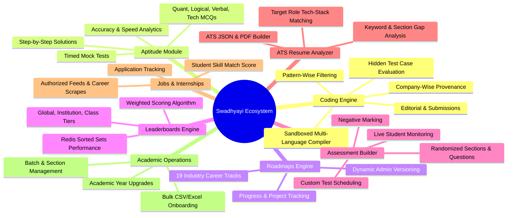
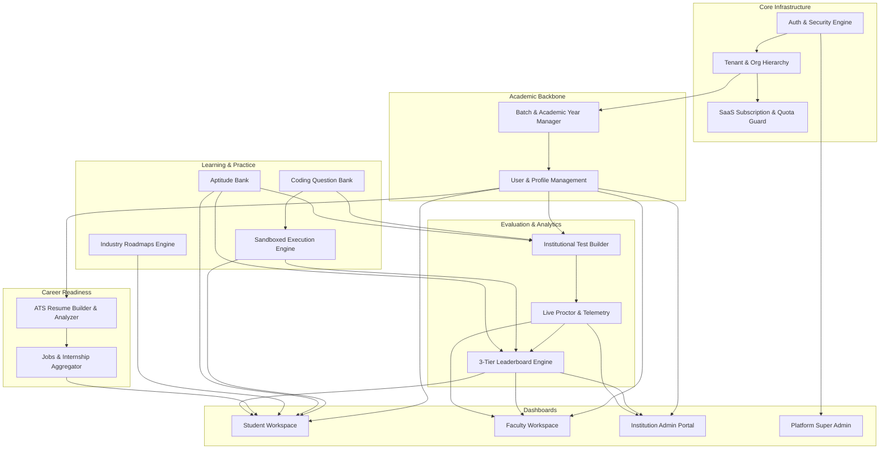
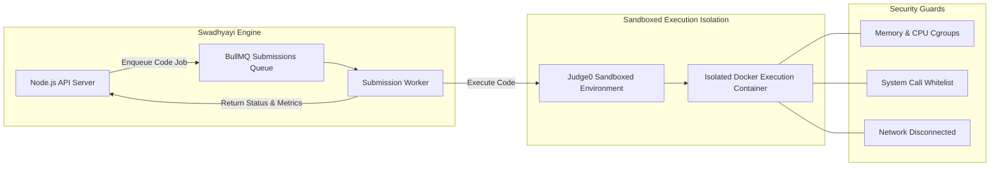
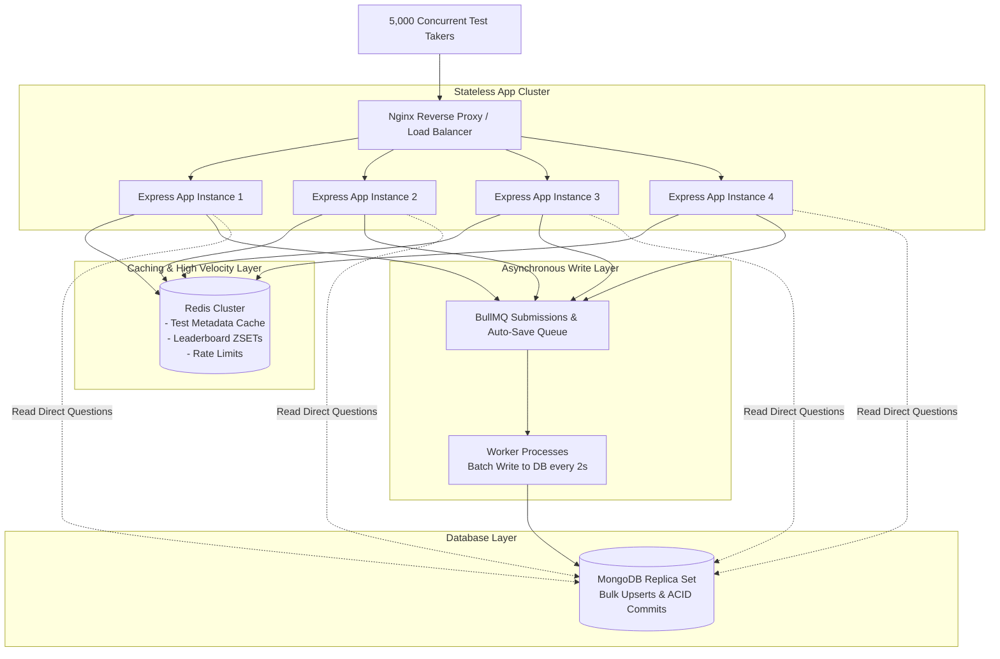
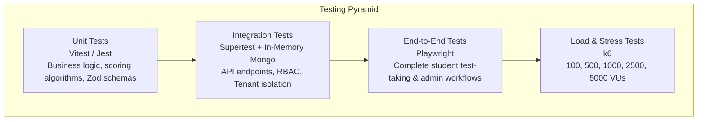

# PROJECT SWADHYAYI
## Reverse Engineering Analysis (REA) & Master System Architecture Report

**Document Version:** 1.0.0  
**Status:** Architectural Blueprint & Feasibility Baseline — Ready for Review  
**Target Ecosystem:** B2B Multi-Tenant University & College Placement Preparation Platform  
**Authors:** Principal Software Architect, CTO, Security Engineer, DevOps & QA Leads  

---

## EXECUTIVE SUMMARY

**Swadhyayi** is an enterprise-grade, multi-tenant B2B Software-as-a-Service (SaaS) platform engineered for universities and colleges. Its mission is to transform higher education placement preparation from a fragmented, unmonitored student activity into an institutional, data-driven, and outcome-oriented ecosystem.

By unifying **DSA coding practice with sandboxed evaluation**, **aptitude preparation**, **19 industry-aligned roadmaps**, **three-level competitive leaderboards**, **custom institutional assessments**, **tech-stack specific ATS resume analytics**, and **curated job discovery**, Swadhyayi delivers complete visibility to placement cells and faculty while providing students with a guided path to high-tier industry employability.

This Reverse Engineering Analysis (REA) deconstructs existing market leaders, establishes the end-to-end architectural blueprint, guarantees strict tenant data isolation, outlines a database schema and 5,000-concurrent-user scalability model, and provides a clear 12-milestone engineering roadmap.

---

## 1. PRODUCT FEASIBILITY ANALYSIS

### 1.1 Problem Statement & Industry Friction
Modern university and engineering college placement preparation suffers from severe fragmentation:
1. **Tool Sprawl & High Friction:** Students practice coding on LeetCode/HackerRank, aptitude on IndiaBIX/Sanfoundry, follow roadmaps on Roadmap.sh, craft resumes on generic builders, and search jobs on LinkedIn/Internshala. There is zero continuity or unified analytics.
2. **Institutional Blind Spot:** University Placement Officers (TPOs) and Deans have no real-time visibility into student competency. Placement readiness is judged post-facto during actual campus recruitment drives, when it is too late to intervene.
3. **Assessment Inefficiencies:** Existing institutional assessment tools (e.g., CoCubes, AMCAT, Mettl) charge steep recurring per-test fees, lack integrated day-to-day practice environments, and provide static PDF reports rather than continuous actionable guidance.

### 1.2 User Personas & Value Propositions
| Persona | Primary Needs & Jobs-to-be-Done | Key Value Delivered by Swadhyayi |
| :--- | :--- | :--- |
| **Student** | Practice coding with patterns, prepare aptitude, follow career roadmaps, optimize resume for ATS, discover verified jobs. | Single dashboard, pattern-based learning, institutional & global benchmarking, immediate compiler feedback, personalized recommendations. |
| **Faculty Member** | Create tests for specific batches/sections, monitor class-level weaknesses, track assignments. | Automated test generation, instant evaluation, granular question-level accuracy reports, anti-cheat test enforcement. |
| **Placement Officer (TPO)** | Identify placement-ready talent, conduct mock tests, track departmental performance, match students to company profiles. | Comprehensive placement readiness index, company-specific test simulations, ATS scoring metrics, exportable audit reports. |
| **Institution Admin** | Manage departments, academic years, sections, faculty allocations, monitor institutional ROI. | Multi-tenant tenant control, batch promotion without data loss, seat quota monitoring, role assignment. |
| **Super Admin (Platform Owner)** | Onboard institutions, manage subscription plans, update global question banks & roadmaps, monitor system health. | Multi-tenant billing, feature toggles, global content governance, aggregate platform telemetry. |

### 1.3 Technical & Commercial Viability
- **Commercially Viable:** Universities already allocate annual budgets for placement training and diagnostic exams (\$5,000–\$40,000/year per institution depending on student headcount). A tiered per-student-per-year or institutional site license SaaS model presents an immediate ROI by replacing multiple fragmented vendor licenses.
- **Technically Viable:** Building a unified MERN + Redis + Sandboxed Judge + Worker Queue architecture is fully achievable with modular monolith design principles, avoiding premature microservice complexity while guaranteeing horizontal scalability to 5,000+ concurrent test-takers.

---

## 2. FUNCTIONAL & NON-FUNCTIONAL REQUIREMENTS BREAKDOWN

### 2.1 Functional Requirements Matrix



#### F-01: Coding Practice Platform
- Categorization by DSA, DP, CP, Problem Solving, and Company-Specific.
- Multi-dimensional filters: Difficulty (Beginner to Expert), Pattern (Two Pointers, Sliding Window, Monotonic Stack, etc.), Topic, Company.
- Verified company interview tag provenance (year, source verification status, report count).
- Code Editor (Monaco / CodeMirror) with C, C++, Java, Python, JavaScript, TypeScript, C#.
- Isolated execution against sample and hidden test cases, reporting Memory, Time, Exit Status (AC, WA, TLE, MLE, RE, CE).

#### F-02: Aptitude Preparation Ecosystem
- Quantitative Aptitude, Logical Reasoning, Verbal Ability, Data Interpretation, Technical MCQs.
- Timed practice modes with adaptive speed tracking and step-by-step explanatory solutions.

#### F-03: Industry-Ready Roadmaps
- 19 Pre-configured tracks (AI, ML, Data Science, Web, MERN, Cloud, DevOps, Cyber, SDE, GenAI, MLOps, etc.).
- Admin-versionable curriculum (stages, prerequisites, hands-on projects, industry tools).
- Student milestone completion tracking.

#### F-04: Three-Level Leaderboard Engine
- Global Tier (Platform-wide across all universities).
- Institution Tier (Internal university ranking).
- Class/Batch Tier (Section-level competition).
- Transparent score calculation based on problem difficulty weights, streak consistency, and test performance, with anti-abuse velocity checks.

#### F-05: Institutional Test Builder & Monitoring
- Test configuration: MCQ + Coding, time windows, duration limits, negative marking, randomized question pools, randomized options.
- Audience targeting: Department, Batch, Class/Section, or individual student whitelist.
- Live submission telemetry: Active participants, time remaining, auto-submission on timeout, anti-tab-switch audit trail.
- Granular analytics: Class average, median, highest/lowest, question discrimination index, weak topic clusters.

#### F-06: ATS-Friendly Resume Builder & Profile Matcher
- Standardized ATS-compliant templates (clean single-column, parseable typography).
- Deep tech-stack matching against 9+ roles (e.g., MERN Developer, Java Developer, Cloud Engineer) evaluating keyword density, missing core competencies, and project alignment.
- Local parsing with privacy preservation (no external data leakage).

#### F-07: Jobs & Internship Discovery
- Curated and authorized job/internship listings with skill-matching algorithms.
- Filters for Location, Remote/Hybrid/Onsite, Experience, Stipend/CTC, and Role.
- Application status tracker (Saved, Applied, Interviewing, Offered, Rejected).

#### F-08: Academic Batch Progression & Administration
- Single-entity institutional hierarchy: `Institution` -> `Department` -> `Batch` (Year) -> `Class/Section`.
- Academic year progression engine: Promotes students to the next academic tier while preserving all historical test attempts, submission logs, and leaderboard records.
- Bulk CSV/Excel student ingestion with schema validation and error reporting.

#### F-09: SaaS Subscription & Super Admin Governance
- Plan tiers (Basic, Professional, Enterprise) with configurable limits: Max Students, Max Faculty, Test Quotas, Coding Execution limits.
- Automated grace period enforcement, renewal notifications, and read-only lockdown on subscription expiration.

---

## 2.2 Non-Functional Requirements (NFRs)

| Dimension | Specification | Verification Method |
| :--- | :--- | :--- |
| **Target Concurrency** | 5,000 active concurrent users executing tests / browsing with sub-second response times. | k6 distributed load tests simulating simultaneous test start and auto-saving. |
| **P95 Latency** | < 150ms for cached reads, < 300ms for transactional database writes, < 2.5s for asynchronous code execution pipeline. | OpenTelemetry / Winston APM tracing and k6 test metrics. |
| **Availability** | 99.9% uptime (excluding scheduled maintenance windows). | Health check probes, multi-container redundancy, graceful process termination. |
| **Tenant Isolation** | Zero cross-tenant data leakage. Strict tenantId scoping at DB query, cache, and token layer. | Automated security regression suite executing IDOR and cross-tenant data queries. |
| **Code Sandboxing** | Total process and network isolation for arbitrary student code execution; 100% defense against fork bombs, unauthorized syscalls, and host filesystem access. | Containerized cgroups, seccomp filters, strict memory/CPU limits, zero host mounts. |
| **Data Integrity** | Complete transactional consistency for test submissions, academic promotions, and scoring calculations. | MongoDB multi-document ACID transactions with retry logic. |
| **Auditability** | 100% of administrative actions, test modifications, and student grade changes logged with user ID, timestamp, and IP address. | Append-only immutable `audit_logs` collection. |

---

## 3. COMPETITOR REVERSE ENGINEERING ANALYSIS

| Platform | Core Strengths | Critical Weaknesses & Gaps | Swadhyayi Architectural Advantage |
| :--- | :--- | :--- | :--- |
| **LeetCode** | Clean UI, massive problem catalog, active discussion forum, excellent compiler feedback. | Purely individual B2C focus. Zero institutional hierarchy, no faculty test builder, no integrated aptitude or ATS resume tools. | Unified ecosystem combining LeetCode-grade coding with institutional multi-tenancy, batch analytics, and college leaderboards. |
| **HackerRank** | Robust enterprise assessment suite, good IDE support. | Expensive for universities; assessment module is detached from continuous student learning; rigid UI; no integrated roadmap or career discovery. | Seamless bridge between daily student practice and formal institutional tests at a fraction of enterprise SaaS pricing. |
| **GeeksforGeeks** | Vast library of articles, practice questions, and company tags. | Cluttered UI with heavy advertisements, unverified/outdated company tags, no real-time class tracking for professors. | Clean, ad-free, verified company provenance, structured pattern-first navigation, and professor tracking dashboards. |
| **InterviewBit / Scaler** | Structured day-by-day track, gamified streak incentives. | Proprietary walled garden focused on upselling high-ticket bootcamps; no university B2B institutional control. | Whitelabeled/customized institutional platform dedicated to university placements rather than private course upselling. |
| **Striver’s A2Z DSA Sheet** | Outstanding pattern-based pedagogical progression; highly loved by Indian college students. | Static web/spreadsheet format. Requires manual ticking of checkboxes; no integrated IDE or automatic institutional verification. | Natively embeds the pattern-based curriculum into an automated interactive judge with automatic tracking and verified metrics. |
| **Roadmap.sh** | Visually intuitive, community-vetted developer career paths. | Static diagrams; lacks interactive coding tie-ins, progress verification, or university assignment hooks. | Dynamic, database-driven roadmaps where nodes directly link to practice questions, projects, and verifiable quizzes. |
| **Resume Worded / Jobscan** | Powerful ATS scoring, keyword optimization algorithms. | Expensive recurring B2C subscription; does not connect directly to college placement drives or technical assessment history. | Integrated ATS analyzer tailored to university tech stacks (MERN, SDE, AI/ML) that verifies student claims against their actual platform coding achievements. |
| **Internshala / Naukri** | High volume of Indian entry-level listings and internships. | Abundant spam/unverified listings, zero integration with college placement cells, disconnected from preparation. | Curated, verified job feeds filtered by actual student skill compatibility scores computed from platform performance. |

---

## 4. SYSTEM ARCHITECTURE PROPOSAL

### 4.1 Architectural Pattern: The Optimized Modular Monolith
Rather than introducing distributed microservices (which create distributed transaction overhead, network latency, complex observability, and deployment brittleness), Swadhyayi is architected as an **Optimized Modular Monolith** with an **Asynchronous Worker Tier**.

```mermaid
flowchart TD
    Client[Web Clients: Students / Faculty / Admins\nReact + TypeScript + Vite + Tailwind CSS]
    
    subgraph Edge Layer
        CDN[Cloudflare / Edge CDN\nStatic Assets & Cached Content]
        ReverseProxy[Nginx Reverse Proxy & SSL Termination\nRate Limiting & Compression]
    end

    subgraph Application Tier [Node.js + Express + TypeScript Modular Monolith]
        Router[API Gateway & Router\n/api/v1/...]
        AuthMiddleware[Auth & Tenant Scoping Middleware\nJWT + RBAC + Tenant Isolation]
        
        subgraph Domain Modules
            M_Auth[Auth & Tenant Module]
            M_Coding[Coding Practice Module]
            M_Aptitude[Aptitude Module]
            M_Roadmap[Roadmap Engine]
            M_Test[Institutional Test Builder]
            M_Board[Leaderboard Engine]
            M_Resume[ATS Resume Module]
            M_Jobs[Jobs Discovery Module]
            M_Admin[Admin & Analytics Module]
        end
    end

    subgraph Asynchronous Execution Tier
        BullMQ[BullMQ Message Queue\nRedis-Backed]
        Worker_Judge[Judge Runner Workers\nSandboxed Execution Pipeline]
        Worker_ATS[ATS Parser Workers\nPDF Text Extraction & NLP]
        Worker_Batch[Batch Import & Upgrades\nCSV/Excel Stream Workers]
        Worker_Stats[Leaderboard & Analytics Aggregator]
    end

    subgraph Isolated Code Execution Sandbox
        JudgeSandbox[Judge0 / Docker Sandboxed Containers\nSeccomp + Cgroups + Network Disabled]
    end

    subgraph Persistence & Cache Tier
        MongoDB[(MongoDB Replica Set\nPrimary DB + Tenant Discriminator)]
        RedisCache[(Redis In-Memory Cache\nLeaderboard ZSETs + Sessions + Rate Limiting)]
        ObjectStorage[(S3 / MinIO Compatible Storage\nResumes, Bulk Exports, Assets)]
    end

    Client --> CDN
    CDN --> ReverseProxy
    ReverseProxy --> Router
    Router --> AuthMiddleware
    AuthMiddleware --> Domain Modules

    M_Coding -->|Enqueue Submission| BullMQ
    M_Resume -->|Enqueue Parse Task| BullMQ
    M_Admin -->|Enqueue Bulk Import| BullMQ
    M_Test -->|Auto-submit on Deadline| BullMQ

    BullMQ --> Worker_Judge
    BullMQ --> Worker_ATS
    BullMQ --> Worker_Batch
    BullMQ --> Worker_Stats

    Worker_Judge --> JudgeSandbox
    Domain Modules --> MongoDB
    Domain Modules --> RedisCache
    Worker_Stats --> RedisCache
    Worker_Stats --> MongoDB
    M_Resume --> ObjectStorage
```

### 4.2 Key Architectural Components
1. **Frontend Client:** Single Page Application (SPA) built with React 18/19, TypeScript, Vite, TanStack Query (React Query) for server-state caching, Tailwind CSS for uniform styling, and Monaco Editor for professional coding.
2. **Modular Express Core:** Decoupled internal modules adhering to clean architecture principles: Controller -> Service -> Repository/Model. Modules communicate via direct in-process service calls or domain events.
3. **Queue Infrastructure:** BullMQ backed by Redis for offloading heavy, non-blocking tasks (code compilation, PDF ATS parsing, bulk student CSV ingestion, test score batching).
4. **Isolated Code Runner:** A dedicated sandboxed execution environment (Judge0 self-hosted or isolated Docker worker pool) preventing any student code from accessing the host filesystem, internal network, or host kernel.

---

## 5. MULTI-TENANT ARCHITECTURE & STRICT DATA ISOLATION

### 5.1 Multi-Tenancy Strategy: Shared Database with Discriminator Field
Swadhyayi implements a **Shared Process, Shared Database with Discriminator (`institutionId`)** strategy.

```
                                      [ Incoming HTTP Request ]
                                                  │
                                                  ▼
                                      [ JWT Authentication ]
                                    (Extracts userId & institutionId)
                                                  │
                                                  ▼
                                      [ Tenant Context Store ]
                                      (AsyncLocalStorage AsyncHook)
                                                  │
                                                  ▼
                        ┌───────────────────────────────────────────────────┐
                        │              Query Middleware / Plugin            │
                        │ Automatically injects { institutionId } filter    │
                        │ Prevents cross-tenant leaks on find/update/delete │
                        └───────────────────────────────────────────────────┘
                                                  │
                                                  ▼
                                        [ MongoDB Database ]
```

#### Why Not Database-per-Tenant?
- Managing hundreds of separate MongoDB databases creates connection pool exhaustion, migration nightmares, high maintenance overhead, and excessive infrastructure costs for higher education tier institutions.
- Shared database with compound indexing (`{ institutionId: 1, ... }`) provides line-rate query speeds and simplified global operations (e.g., Global Leaderboard, Global Question Bank).

### 5.2 Tenant Isolation Safeguards
1. **Automated Tenant Scoping Plugin:** A custom Mongoose plugin automatically appends `{ institutionId: currentTenantId }` to every `find`, `findOne`, `findOneAndUpdate`, `countDocuments`, and `aggregate` query unless explicitly operating on global collections (`questions_coding`, `roadmaps`) or invoked by a verified `SuperAdmin`.
2. **Context Propagation via `AsyncLocalStorage`:** The authenticated user's `institutionId` is stored in Node.js `AsyncLocalStorage`, ensuring the repository layer has access to tenant context without relying on parameter passing.
3. **Defense-in-Depth IDOR Prevention:** Every mutation and read verifies that the requested resource ID belongs to the tenant stored in the caller's cryptographically verified JWT payload.
4. **Cache Key Namespacing:** All tenant-specific Redis keys are namespaced with the tenant identifier:
   `cache:tenant:<institutionId>:leaderboard:class:<classId>`

---

## 6. COMPLETE DATABASE SCHEMA PROPOSAL

The database is designed around MongoDB with optimized compound indexes, strict type definitions, and reference integrity.

```mermaid
erDiagram
    INSTITUTION ||--o{ DEPARTMENT : contains
    INSTITUTION ||--o{ BATCH : manages
    INSTITUTION ||--o{ USER : employs_or_enrolls
    INSTITUTION ||--o{ TEST : creates
    INSTITUTION ||--o{ SUBSCRIPTION : holds

    DEPARTMENT ||--o{ CLASS : has
    BATCH ||--o{ CLASS : divides_into
    CLASS ||--o{ USER : enrolls

    USER ||--o{ SUBMISSION_CODING : submits
    USER ||--o{ TEST_ATTEMPT : takes
    USER ||--o{ RESUME : creates
    USER ||--o{ ROADMAP_PROGRESS : tracks

    QUESTION_CODING ||--o{ SUBMISSION_CODING : evaluated_in
    TEST ||--o{ TEST_ATTEMPT : produces
```

### 6.1 Core Collection Schemas

#### 1. `institutions`
```typescript
interface IInstitution {
  _id: ObjectId;
  name: string;                   // e.g., "National Institute of Technology"
  code: string;                   // Unique slug e.g., "nit-surat"
  contactEmail: string;
  phone?: string;
  address: {
    city: string;
    state: string;
    country: string;
    zipCode: string;
  };
  subscriptionId: ObjectId;       // Ref: subscriptions
  status: 'ACTIVE' | 'SUSPENDED' | 'EXPIRED' | 'TRIAL';
  settings: {
    allowedDomains: string[];     // e.g. ["@nitsurat.ac.in"]
    branding: {
      logoUrl?: string;
      primaryColor?: string;
    };
    enableProctoring: boolean;
  };
  createdAt: Date;
  updatedAt: Date;
}
// Indexes: { code: 1 } UNIQUE, { status: 1 }
```

#### 2. `departments`, `batches`, and `classes`
```typescript
interface IDepartment {
  _id: ObjectId;
  institutionId: ObjectId;       // Ref: institutions
  name: string;                  // e.g., "Computer Science & Engineering"
  code: string;                  // e.g., "CSE"
  status: 'ACTIVE' | 'ARCHIVED';
}
// Indexes: { institutionId: 1, code: 1 } UNIQUE

interface IBatch {
  _id: ObjectId;
  institutionId: ObjectId;       // Ref: institutions
  name: string;                  // e.g., "Batch 2023-2027"
  graduationYear: number;        // e.g., 2027
  currentAcademicYear: number;   // 1, 2, 3, 4
  status: 'ACTIVE' | 'GRADUATED' | 'ARCHIVED';
}
// Indexes: { institutionId: 1, graduationYear: 1 }

interface IClass {
  _id: ObjectId;
  institutionId: ObjectId;
  departmentId: ObjectId;        // Ref: departments
  batchId: ObjectId;             // Ref: batches
  section: string;               // e.g., "A", "B", "CS-1"
  semester: number;              // 1 to 8
}
// Indexes: { institutionId: 1, departmentId: 1, batchId: 1, section: 1 } UNIQUE
```

#### 3. `users`
```typescript
interface IUser {
  _id: ObjectId;
  institutionId?: ObjectId;      // Null only for Super Admin
  email: string;
  passwordHash: string;
  role: 'SUPER_ADMIN' | 'INSTITUTION_ADMIN' | 'PLACEMENT_OFFICER' | 'FACULTY' | 'STUDENT';
  firstName: string;
  lastName: string;
  rollNumber?: string;           // Student roll / enrollment number
  departmentId?: ObjectId;
  batchId?: ObjectId;
  classId?: ObjectId;
  profile: {
    avatarUrl?: string;
    phoneNumber?: string;
    githubUrl?: string;
    linkedinUrl?: string;
    portfolioUrl?: string;
  };
  metrics: {
    codingProblemsSolved: number;
    aptitudeTestsTaken: number;
    globalRank: number;
    institutionRank: number;
    currentStreak: number;
    longestStreak: number;
    lastActiveDate: Date;
    totalPoints: number;
  };
  status: 'ACTIVE' | 'INACTIVE' | 'SUSPENDED';
  refreshTokenHash?: string;
  createdAt: Date;
  updatedAt: Date;
}
// Indexes: { email: 1 } UNIQUE, { institutionId: 1, role: 1 }, { institutionId: 1, rollNumber: 1 }
```

#### 4. `questions_coding`
```typescript
interface IQuestionCoding {
  _id: ObjectId;
  title: string;
  slug: string;                  // e.g., "two-sum"
  description: string;           // Markdown
  difficulty: 'BEGINNER' | 'EASY' | 'MEDIUM' | 'HARD' | 'EXPERT';
  patterns: string[];            // ["Two Pointers", "Hashing"]
  topics: string[];              // ["Array", "Hash Table"]
  companyTags: {
    company: string;             // e.g., "Google"
    yearReported: number;
    verified: boolean;
    frequencyCount: number;
  }[];
  supportedLanguages: string[];  // ["c", "cpp", "java", "python", "javascript", "typescript", "csharp"]
  starterCode: {
    language: string;
    boilerplate: string;
    driverCode: string;
  }[];
  sampleTestCases: {
    input: string;
    output: string;
    explanation?: string;
  }[];
  hiddenTestCases: {
    input: string;
    expectedOutput: string;
    weight: number;
  }[];
  timeLimitMs: number;           // e.g., 2000 ms
  memoryLimitMb: number;         // e.g., 256 MB
  editorial?: {
    solutionMarkdown: string;
    complexityAnalysis: string;
  };
  hints: string[];
  isGlobal: boolean;             // True = visible to all; False = custom institutional
  institutionId?: ObjectId;      // Populated only if custom to a college
  status: 'PUBLISHED' | 'DRAFT' | 'ARCHIVED';
  createdAt: Date;
}
// Indexes: { slug: 1 } UNIQUE, { difficulty: 1 }, { patterns: 1 }, { topics: 1 }, { "companyTags.company": 1 }
```

#### 5. `submissions_coding`
```typescript
interface ISubmissionCoding {
  _id: ObjectId;
  userId: ObjectId;
  institutionId: ObjectId;
  questionId: ObjectId;
  language: string;
  code: string;
  status: 'PENDING' | 'ACCEPTED' | 'WRONG_ANSWER' | 'TIME_LIMIT_EXCEEDED' | 'MEMORY_LIMIT_EXCEEDED' | 'RUNTIME_ERROR' | 'COMPILATION_ERROR';
  executionTimeMs: number;
  memoryUsedKb: number;
  testCasesPassed: number;
  totalTestCases: number;
  errorLog?: string;
  isContestSubmission: boolean;
  testId?: ObjectId;
  createdAt: Date;
}
// Indexes: { userId: 1, questionId: 1, status: 1 }, { institutionId: 1, createdAt: -1 }
```

#### 6. `questions_aptitude`
```typescript
interface IQuestionAptitude {
  _id: ObjectId;
  category: 'QUANTITATIVE' | 'LOGICAL_REASONING' | 'VERBAL_ABILITY' | 'DATA_INTERPRETATION' | 'TECHNICAL_MCQ';
  subcategory: string;           // e.g., "Permutations & Combinations", "Pointers in C"
  difficulty: 'BEGINNER' | 'EASY' | 'MEDIUM' | 'HARD';
  questionText: string;
  options: {
    id: string;
    text: string;
  }[];
  correctOptionId: string;
  explanation: string;
  isGlobal: boolean;
  institutionId?: ObjectId;
  status: 'PUBLISHED' | 'DRAFT';
}
// Indexes: { category: 1, subcategory: 1, difficulty: 1 }
```

#### 7. `roadmaps` & `user_roadmap_progress`
```typescript
interface IRoadmap {
  _id: ObjectId;
  title: string;                 // e.g., "Full Stack MERN Development"
  slug: string;
  domain: string;
  description: string;
  version: number;               // Auto-incrementing version
  estimatedHours: number;
  stages: {
    stageOrder: number;
    title: string;
    description: string;
    nodes: {
      nodeId: string;
      title: string;
      description: string;
      prerequisites: string[];
      resources: { title: string; url: string; type: 'ARTICLE' | 'VIDEO' | 'DOCS' }[];
      recommendedProjects: { title: string; description: string; githubStarter?: string }[];
      linkedCodingQuestionIds?: ObjectId[];
    }[];
  }[];
  isPublished: boolean;
}
// Indexes: { slug: 1 } UNIQUE, { domain: 1 }

interface IUserRoadmapProgress {
  _id: ObjectId;
  userId: ObjectId;
  institutionId: ObjectId;
  roadmapId: ObjectId;
  completedNodeIds: string[];
  currentStage: number;
  completionPercentage: number;
  updatedAt: Date;
}
// Indexes: { userId: 1, roadmapId: 1 } UNIQUE
```

#### 8. `tests` & `test_attempts`
```typescript
interface ITest {
  _id: ObjectId;
  institutionId: ObjectId;
  creatorId: ObjectId;           // Faculty or Admin
  title: string;
  description: string;
  instructions: string;
  targetScope: {
    allStudents: boolean;
    departmentIds: ObjectId[];
    batchIds: ObjectId[];
    classIds: ObjectId[];
    whitelistedUserIds: ObjectId[];
  };
  windowStart: Date;             // Test availability window start
  windowEnd: Date;               // Test availability window end
  durationMinutes: number;       // e.g., 90 minutes
  randomizeQuestions: boolean;
  randomizeOptions: boolean;
  sections: {
    name: string;
    sectionType: 'CODING' | 'APTITUDE' | 'MIXED';
    durationMinutes?: number;
    questions: {
      questionId: ObjectId;
      questionType: 'CODING' | 'APTITUDE';
      marks: number;
      negativeMarks: number;
    }[];
  }[];
  proctorSettings: {
    blockTabSwitch: boolean;
    maxTabSwitchesAllowed: number;
    forceFullScreen: boolean;
  };
  status: 'DRAFT' | 'SCHEDULED' | 'LIVE' | 'COMPLETED' | 'CANCELLED';
  createdAt: Date;
}
// Indexes: { institutionId: 1, status: 1, windowStart: 1 }

interface ITestAttempt {
  _id: ObjectId;
  testId: ObjectId;
  userId: ObjectId;
  institutionId: ObjectId;
  startTime: Date;
  submitTime?: Date;
  status: 'IN_PROGRESS' | 'SUBMITTED' | 'AUTO_SUBMITTED' | 'DISQUALIFIED';
  answers: {
    questionId: ObjectId;
    selectedOptionId?: string;   // For MCQs
    codeSubmissionId?: ObjectId; // For Coding questions
    isCorrect?: boolean;
    marksAwarded: number;
  }[];
  totalScore: number;
  tabSwitchViolations: number;
  sectionBreakdown: {
    sectionName: string;
    score: number;
    totalPossible: number;
  }[];
}
// Indexes: { testId: 1, userId: 1 } UNIQUE, { testId: 1, totalScore: -1 }
```

#### 9. `resumes`
```typescript
interface IResume {
  _id: ObjectId;
  userId: ObjectId;
  institutionId: ObjectId;
  templateId: string;
  parsedContent: {
    personalInfo: { fullName: string; email: string; phone: string; location: string; links: string[] };
    education: { institution: string; degree: string; score: string; year: string }[];
    skills: { category: string; skills: string[] }[];
    projects: { title: string; techStack: string[]; description: string[]; liveLink?: string }[];
    experience: { company: string; role: string; duration: string; highlights: string[] }[];
    certifications: string[];
  };
  analysisHistory: {
    targetProfile: string;        // e.g. "MERN Stack Developer"
    compatibilityScore: number;  // 0 - 100
    matchedKeywords: string[];
    missingKeywords: string[];
    criticalMissingSkills: string[];
    sectionScores: { section: string; score: number; feedback: string }[];
    analyzedAt: Date;
  }[];
  pdfStoragePath?: string;
  updatedAt: Date;
}
// Indexes: { userId: 1 } UNIQUE, { institutionId: 1 }
```

#### 10. `jobs`
```typescript
interface IJob {
  _id: ObjectId;
  title: string;
  company: string;
  companyLogoUrl?: string;
  source: 'LINKEDIN' | 'INDEED' | 'INTERNSHALA' | 'NAUKRI' | 'CAMPUS_DRIVE';
  originalUrl: string;
  location: string;
  workMode: 'REMOTE' | 'HYBRID' | 'ONSITE';
  jobType: 'INTERNSHIP' | 'FULL_TIME';
  experienceLevel: 'ENTRY_LEVEL' | '0_TO_1_YEARS' | '1_TO_3_YEARS';
  salaryOrStipend?: string;
  skillsRequired: string[];
  targetDepartments?: string[];
  institutionId?: ObjectId;     // Null if platform-wide feed; populated if college drive
  status: 'ACTIVE' | 'EXPIRED';
  expiresAt: Date;
  createdAt: Date;
}
// Indexes: { status: 1, createdAt: -1 }, { skillsRequired: 1 }
```

---

## 7. MODULE DEPENDENCY GRAPH



---

## 8. API ARCHITECTURE & ENDPOINT SPECIFICATION

All API routes follow a standard RESTful convention prefixed with `/api/v1`. Responses follow a uniform JSON envelope:

```typescript
// Standard Response Envelope
interface ApiResponse<T> {
  success: boolean;
  data: T | null;
  error: {
    code: string;
    message: string;
    details?: any;
  } | null;
  meta?: {
    page?: number;
    limit?: number;
    totalCount?: number;
    totalPages?: number;
  };
}
```

### 8.1 API Route Map Overview
```
/api/v1
  ├── /auth
  │     POST   /register (Institution onboarding / Student self-invite)
  │     POST   /login (Returns JWT access token + sets secure refresh cookie)
  │     POST   /refresh-token
  │     POST   /logout
  │     GET    /me
  ├── /tenants
  │     GET    /profile
  │     PATCH  /profile
  │     GET    /departments
  │     POST   /departments
  │     GET    /batches
  │     POST   /batches
  │     POST   /batches/upgrade (Academic year transition)
  │     GET    /classes
  │     POST   /classes
  │     POST   /students/bulk-upload (Multipart CSV/Excel)
  ├── /coding
  │     GET    /questions (Filters: difficulty, pattern, topic, company)
  │     GET    /questions/:slug
  │     POST   /run (Runs against sample test cases)
  │     POST   /submit (Runs against hidden test cases via BullMQ)
  │     GET    /submissions/:id
  │     GET    /user-stats
  ├── /aptitude
  │     GET    /categories
  │     GET    /questions (By category & subcategory)
  │     POST   /submit-practice
  │     GET    /analytics
  ├── /roadmaps
  │     GET    /
  │     GET    /:slug
  │     POST   /:slug/progress (Toggle node completion)
  ├── /tests
  │     POST   / (Create test)
  │     GET    / (List assigned tests)
  │     GET    /:id (Details & sections)
  │     POST   /:id/start (Initialize attempt)
  │     POST   /:id/save-answer (Auto-save debounce)
  │     POST   /:id/submit (Finalize test)
  │     GET    /:id/results (Analytics)
  ├── /leaderboards
  │     GET    /global
  │     GET    /institution
  │     GET    /class/:classId
  ├── /resume
  │     GET    /
  │     POST   / (Save resume structure)
  │     POST   /analyze (Analyze against target profile)
  │     POST   /export-pdf
  ├── /jobs
  │     GET    / (Filtered by student skills)
  │     POST   /:id/save
  │     POST   /:id/apply-click
  └── /admin
        GET    /super/institutions
        POST   /super/institutions
        PATCH  /super/subscriptions/:id
        GET    /institutional/overview
        GET    /institutional/analytics/placement-readiness
```

---

## 9. THIRD-PARTY INTEGRATION & ISOLATED EXECUTION REQUIREMENTS



### 9.1 Sandboxed Code Execution Strategy
- **Critical Security Mandate:** Under zero circumstances is student code executed in the Node.js runtime process.
- **Engine Choice:** Self-hosted **Judge0 Community Edition** or isolated Docker containers using Linux cgroups v2, seccomp filters (blocking `fork`, `execve`, socket operations), and network namespaces with zero egress connectivity.
- **Resource Constraints per Execution:**
  - CPU: 2.0 seconds maximum wall clock execution time.
  - Memory: 256MB to 512MB RAM cap.
  - File Size: Maximum 10MB temporary binary/source size.
  - Process Count: Max 30 PID limit (prevention of fork bombs).

### 9.2 ATS Resume Parsing Engine
- Completely self-hosted text extraction pipeline using `pdf-parse` / `unpdf` with AST tokenizers.
- Prevents sending confidential student resumes to external third-party AI APIs without explicit institutional data agreement.
- Keyword and skill extraction matching using industry-standard tech stack taxonomies (built via pattern databases and TF-IDF / fuzzy string matching).

### 9.3 Job Feeds & Aggregation Integrity
- Integration with authorized partner RSS feeds, verified corporate career page scrapers, and institutional placement cell manual postings.
- Canonical deduplication via fuzzy matching on `{ company, jobTitle, location }`.
- Clear provenance labels displaying the exact source and direct application destination.

---

## 10. SECURITY THREAT ANALYSIS (STRIDE MODEL)

| STRIDE Category | Threat Description | Swadhyayi Countermeasure & Mitigation |
| :--- | :--- | :--- |
| **Spoofing** | Attacker impersonates faculty or student of another college. | Strict JWT signature verification (RS256 / HS256 with strong secrets), httpOnly rotating refresh tokens with Redis revocation blacklist. |
| **Tampering** | Student alters test score or manipulates test duration in request payload. | All scoring occurs strictly server-side. Test duration is tracked via server timestamps (`startTime` + `durationMinutes`), discarding late submissions. |
| **Repudiation** | Administrator or faculty denies deleting a test or altering student grades. | Append-only immutable `audit_logs` tracking user ID, IP address, user agent, before/after diffs, and action names. |
| **Information Disclosure** | Student accesses hidden test cases or College A views College B's placement records (IDOR). | Hidden test cases are never returned to client responses; MongoDB multi-tenant query filter plugin strictly scopes queries by `institutionId`. |
| **Denial of Service** | Student writes infinite loops (`while(true)`) or fork bombs in coding editor. | Execution timeouts enforced by Judge0 / Linux cgroups; API endpoints protected by `express-rate-limit` and Redis leaky-bucket throttlers. |
| **Elevation of Privilege** | Student sends payload with `role: "INSTITUTION_ADMIN"`. | Strict backend Zod validation stripping protected fields from request bodies; role checking middleware enforcing granular RBAC on every route. |

---

## 11. PERFORMANCE & 5,000 CONCURRENT USERS SCALABILITY STRATEGY

### 11.1 Workload Model for 5,000 Concurrent Users
A typical critical load spike occurs during an institution-wide placement test:
- **Active Users:** 5,000 concurrent students active simultaneously.
- **Action Profile:**
  - 80% reading questions & drafting answers locally in browser.
  - 15% triggering periodic auto-save of MCQ responses (every 30–60s).
  - 5% executing coding tests or submitting final papers (burst of 250 requests/sec).

### 11.2 Architectural Sizing & Bottleneck Elimination



1. **Test Auto-Save Debouncing & Batching:**
   Instead of 5,000 concurrent individual database writes every time an option is clicked, the client debounces answer state, sending batched updates. Express ingests these into Redis or a lightweight BullMQ queue, which flushes bulk upserts (`bulkWrite`) to MongoDB every 2 seconds.
2. **Leaderboard Calculations at Scale:**
   Leaderboards are **never computed using dynamic MongoDB `$group` or `$sort` aggregations during live user requests**. Instead, rankings are maintained in real-time inside **Redis Sorted Sets (`ZSET`)**:
   `ZADD leaderboard:institution:<id> <points> <userId>`
   `ZREVRANGE leaderboard:institution:<id> 0 99 WITHSCORES` (Executed in $O(\log N + M)$, yielding sub-5ms responses even with 100,000 entries).
3. **Connection Pooling & Query Optimization:**
   - Mongoose connection pool sized to `maxPoolSize: 100` per Node instance.
   - All high-frequency queries covered by compound indexes (e.g., `{ institutionId: 1, testId: 1, userId: 1 }`).
   - Projection filters used on every query (`.select('title difficulty patterns')`) to avoid fetching heavy editorial/testcase blobs into Node memory.

---

## 12. QA & TESTING STRATEGY (ZERO TOLERANCE POLICY)

In accordance with Phase 8, no feature will be marked complete without passing the mandatory testing matrix.



### 12.1 Test Coverage Standards
- **Unit & Schema Tests:** 100% coverage of Zod request validation, scoring calculation formulas, and ATS keyword extraction logic.
- **Integration Tests (API & Auth):** Every API endpoint tested for:
  - 200/201 Success path with valid data.
  - 400 Bad Request on invalid payloads.
  - 401 Unauthorized on missing/expired tokens.
  - 403 Forbidden on role mismatch (e.g., student attempting to create a test).
  - 403/404 on cross-tenant IDOR attack (Tenant A querying Tenant B resource).
- **End-to-End (E2E) Test Journeys:**
  - Journey 1: Student solves coding problem -> compiler returns status -> score increments on class leaderboard.
  - Journey 2: Faculty schedules test -> Student takes test with simulated tab switches -> Test auto-submits -> Analytics generated.
  - Journey 3: Student creates resume -> Analyzes against MERN profile -> Score & recommendations rendered.
- **Load Testing Benchmarks (k6):**
  - Scenario: 5,000 Virtual Users (VUs) ramping over 3 minutes, executing randomized test answer submissions.
  - Target Pass Criteria: Error rate < 0.1%, P95 latency < 400ms.

---

## 13. DEVELOPMENT MILESTONES & IMPLEMENTATION ROADMAP

```mermaid
gantt
    title Swadhyayi Engineering Roadmap (Milestones 1 - 12)
    dateFormat  X
    axisFormat %d

    section Phase 1: Core Foundation
    M1: Foundation, Auth & Tenant Engine       :active, 0, 10
    M2: Student Ecosystem & Academic Batches   :10, 20

    section Phase 2: Learning Platforms
    M3: Coding Practice & Sandboxed Judge      :20, 35
    M4: Aptitude Preparation Ecosystem         :35, 45
    M5: Industry Roadmaps Engine               :45, 55

    section Phase 3: Competition & Assessment
    M6: 3-Tier Leaderboard Engine              :55, 65
    M7: Institutional Test Builder & Proctor   :65, 80

    section Phase 4: Career Readiness
    M8: ATS Resume Builder & Analyzer          :80, 95
    M9: Jobs & Internships Discovery           :95, 105

    section Phase 5: SaaS & Production
    M10: SaaS Admin & Billing Engine           :105, 115
    M11: 5K Load Testing & Performance Polish  :115, 125
    M12: Docker, CI/CD & Production Release    :125, 135
```

- **Milestone 1 — Foundation & Multi-Tenancy:** Project scaffolding (Vite React TS + Express TS), MongoDB schemas, JWT authentication, RBAC middleware, Tenant isolation plugin, base UI design system.
- **Milestone 2 — Academic Hierarchy & Student Ecosystem:** Department, Batch, Class management, student onboarding, bulk CSV import, profile settings.
- **Milestone 3 — Coding Platform & Compiler:** Monaco editor integration, Judge0 / isolated execution sandbox, testcase runner, company and pattern filtering, submission history.
- **Milestone 4 — Aptitude Engine:** MCQ bank, categorized practice modes, timed drills, speed/accuracy analytics.
- **Milestone 5 — Dynamic Roadmaps:** 19 pre-populated tracks, node tracking, project links, admin curriculum versioning.
- **Milestone 6 — Three-Level Leaderboards:** Redis Sorted Sets integration, Global/Institution/Class leaderboards, streak tracking, anti-cheat scoring.
- **Milestone 7 — Institutional Test Builder:** Scheduled test creation, question pool randomization, live candidate telemetry, student test UI with tab-switch warnings, automated evaluation.
- **Milestone 8 — ATS Resume Builder & Analyzer:** Clean resume templates, JSON-resume export, PDF rendering, tech-stack keyword analyzer.
- **Milestone 9 — Jobs & Internships Portal:** Job listing aggregation, student skill-matching score, application tracking.
- **Milestone 10 — SaaS Management & Super Admin:** Subscription tiers, quota enforcement, billing history, global content management.
- **Milestone 11 — Security & Performance Optimization:** k6 load testing (up to 5,000 VUs), Redis caching layers, query profiling, security audit.
- **Milestone 12 — Production DevOps & Documentation:** Docker multi-stage builds, Docker Compose, Nginx reverse proxy, CI/CD pipelines, complete system documentation.

---

## 14. ESTIMATED TECHNICAL COMPLEXITY & RISK MATRIX

| Module / Subsystem | Complexity | Primary Risk Factor | Mitigation Strategy |
| :--- | :---: | :--- | :--- |
| **Sandboxed Code Execution** | **CRITICAL (High)** | Malicious student code (RCE, fork bomb, memory exhaustion, network probing). | Use proven isolated runtime (Judge0 / isolated Docker worker) with strict cgroups, non-root user, and disabled networking. |
| **Institutional Test Builder & Live Proctoring** | **HIGH** | Simultaneous load spikes at test start; data loss during network hiccups; cheating. | Client-side IndexedDB caching of unsubmitted answers; debounced BullMQ auto-save queue; server-side time enforcement. |
| **ATS Resume Analyzer** | **MEDIUM** | Diverse, unstructured PDF formatting causing parsing errors or false-negative scores. | Standardize on structural AST parsing; guide students using built-in ATS templates; transparent scoring criteria. |
| **Three-Level Leaderboard Engine** | **MEDIUM** | Expensive DB aggregations degrading under high student traffic. | Maintain live rankings strictly in Redis Sorted Sets; snapshot to MongoDB asynchronously via background cron. |
| **Multi-Tenant Academic Batch Upgrade** | **MEDIUM** | Data corruption or lost test histories during student promotion to next year. | Soft academic progression: mutate user's `currentBatchId` and `semester` while retaining immutable historical submission references. |

---

## 15. RECOMMENDED TECHNOLOGY & INFRASTRUCTURE STACK

| Layer | Recommended Choice | Rationale & Justification |
| :--- | :--- | :--- |
| **Frontend Framework** | **React 18 / 19 + TypeScript + Vite** | Ultra-fast HMR, strict type safety, industry standard for dashboard applications. |
| **UI Styling & Components** | **Tailwind CSS + Lucide Icons + Headless UI** | Zero CSS bloat, modern enterprise aesthetics, accessible primitives. |
| **State & Server Cache** | **TanStack Query (React Query) + Zustand** | Declarative data fetching, automatic background revalidation, minimal client-side boilerplate. |
| **Code Editor** | **Monaco Editor (`@monaco-editor/react`)** | Same engine as VS Code; full language syntax highlighting, auto-complete, and keybinding support. |
| **Backend Runtime** | **Node.js (LTS) + Express.js + TypeScript** | High I/O throughput, vast ecosystem, unified TypeScript typings across frontend and backend. |
| **API Validation** | **Zod** | Runtime request body validation with inferred TypeScript types, preventing invalid inputs. |
| **Primary Database** | **MongoDB (Replica Set) + Mongoose** | Flexible document model for complex nested questions, test sections, and resume ASTs. |
| **Cache & Queue Broker** | **Redis (v7+) + BullMQ** | Sub-millisecond leaderboard operations (`ZSET`), atomic rate-limiting, robust job queueing. |
| **Code Runner** | **Judge0 CE (Self-Hosted Docker)** | Battle-tested, sandboxed, multi-language execution engine with memory and CPU isolation. |
| **PDF Generation** | **Puppeteer / React-PDF** | Pixel-perfect ATS-compliant PDF generation directly from structured JSON. |
| **DevOps & Containers** | **Docker, Docker Compose, Nginx** | Reproducible builds, easy multi-container orchestration, production-ready reverse proxy. |

---

## 16. IDENTIFIED AMBIGUITIES, ARCHITECTURAL DECISIONS & OPEN QUESTIONS

Before proceeding to Milestone 1 implementation, the following key engineering choices are presented for architectural confirmation:

1. **Code Execution Infrastructure:**
   - *Option A (Recommended):* Self-host a Judge0 CE container within Docker Compose for full local control, unlimited free submissions, and low latency.
   - *Option B:* Connect to an external Judge0 cloud API via API key (requires external internet connectivity and API quota).
   - *Recommendation:* Option A for enterprise-grade self-contained deployment.

2. **Proctoring Privacy & Scope:**
   - *Option A (Recommended):* Non-invasive browser proctoring (tab-switch tracking, fullscreen enforcement, copy-paste prevention).
   - *Option B:* Advanced webcam/microphone proctoring with automated face detection.
   - *Recommendation:* Option A initially, keeping webcam proctoring as an opt-in configurable enterprise module to respect student privacy and bandwidth constraints.

3. **Job Portal Ingestion Source:**
   - *Option A (Recommended):* Curated job feed integration (verified RSS/API feeds, college placement drives, and manually vetted postings) with real-time skill matching.
   - *Option B:* Unofficial web scraping of public boards (susceptible to breakages and anti-bot IP blocks).
   - *Recommendation:* Option A ensures legal compliance, high data quality, and zero bot-blocking risks.

---

## NEXT STEP: ARCHITECTURAL APPROVAL

With this comprehensive Reverse Engineering Analysis and Master Architecture Report established, we are prepared to initialize **Milestone 1: Project Foundation, Modular Monolith Scaffolding, Authentication & Multi-Tenancy Engine**.

Please review and confirm architectural approval to commence implementation.