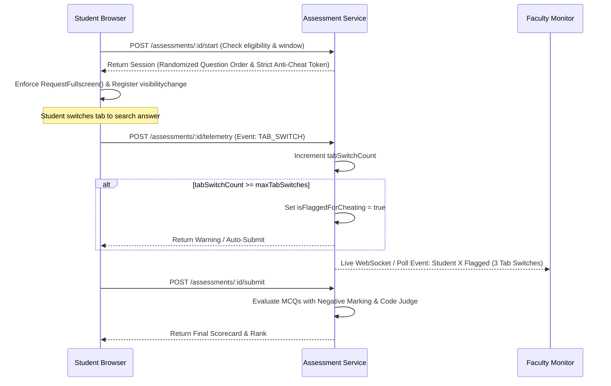

# REVERSE ENGINEERING ANALYSIS (REA) — MILESTONE 7: INSTITUTIONAL TEST BUILDER & LIVE PROCTORING

## 1. Executive Problem Statement & Motivation
University placement cells (TPOs) and faculty coordinators require an enterprise-grade assessment platform capable of simulating real corporate hiring tests (e.g., TCS NQT, Cognizant GenC, Infosys InfyTQ, Amazon Online Assessments, Capgemini, Google OA).

Existing open coding platforms (LeetCode, CodeChef) lack:
1. **Institutional Access Control & Targeting:** Tests cannot be restricted to specific student cohorts (e.g. "B.Tech CSE Batch of 2027, Sections A & B only").
2. **Hybrid Multi-Section Structure:** Placement tests always feature mixed sections: Quantitative Aptitude (20 mins) + Logical Reasoning (15 mins) + Core CS (15 mins) + 2 Algorithmic Coding Problems (45 mins). Single-purpose platforms force universities to pay for multiple fragmented SaaS tools.
3. **Anti-Cheat & Proctoring Telemetry:** Remote and lab-based campus assessments suffer from massive malpractice (screen sharing, tab switching to ChatGPT/Google, external copy-pasting). Colleges require real-time violation monitoring, tab-switch logging, and automated integrity flagging.
4. **Placement Shortlist Export:** Placement officers need instant generation of candidate shortlists with cutoffs and section-level discrimination.

---

## 2. Competitive Reverse Engineering Matrix

| Feature | HackerEarth / HackerRank for Work | Mercer Mettl | Cocubes / Wheebox | Swadhyayi Test Engine |
| :--- | :--- | :--- | :--- | :--- |
| **Multi-Tenancy** | Enterprise seat per user | Enterprise license | Corporate B2B | **Native multi-tenant isolation by `institutionId`** |
| **Hybrid Sections (MCQ + Code)** | Yes | Yes (Separate modules) | Yes | **Unified single session with section-level timers & cutoffs** |
| **Targeted Cohorts** | Email invitations only | Batch CSV upload | Rigid groups | **Dynamic mapping by Department, Batch, and Class Section** |
| **Live Telemetry & Proctoring** | Camera + Web lock | AI video proctoring | Browser lock | **Browser security (Fullscreen, Tab-switch audit, Blur, Paste lock)** |
| **Question Pool Shuffling** | Yes | Yes | Limited | **Randomized question order & option shuffling per candidate** |
| **Negative Marking** | Standard | Yes | Yes | **Configurable per section (-0.25, -0.5, 0)** |
| **TPO Shortlist Export** | CSV export | Excel | PDF/Excel | **Real-time cohort distribution, rank, percentile, and CSV export** |

---

## 3. Data & Entity Architecture

### 3.1 `Assessment` Schema
```typescript
{
  institutionId: ObjectId;            // Tenant scoping
  createdBy: ObjectId;                // Faculty / TPO ref User
  title: string;
  description: string;
  type: 'PLACEMENT_MOCK' | 'CONTEST' | 'SEMESTER_EXAM' | 'PRACTICE';
  status: 'DRAFT' | 'PUBLISHED' | 'ARCHIVED';
  
  // Timing
  startTime: Date;
  endTime: Date;
  durationMinutes: number;            // Total test duration
  
  // Audience Scoping
  targeting: {
    allStudents: boolean;
    departmentIds: ObjectId[];
    batchIds: ObjectId[];
    classIds: ObjectId[];
    accessCode?: string;              // Optional passcode
  };
  
  // Sections
  sections: [
    {
      sectionId: string;
      title: string;                  // e.g. 'Quantitative Aptitude' or 'Coding Round'
      type: 'APTITUDE' | 'CODING';
      order: number;
      durationMinutes?: number;       // Optional section-specific time limit
      negativeMarkingRatio: number;   // e.g. 0.25 (deduct 25% of points for incorrect answer)
      passingCutoffPercentage: number;
      questions: [
        {
          questionId: ObjectId;
          type: 'APTITUDE' | 'CODING';
          points: number;
        }
      ]
    }
  ];
  
  // Proctoring Rules
  proctoring: {
    enableProctoring: boolean;
    maxTabSwitches: number;           // Default 3
    enforceFullscreen: boolean;
    blockCopyPaste: boolean;
    autoSubmitOnViolationLimit: boolean;
  };
}
```

### 3.2 `AssessmentSession` Schema (Student Attempt)
```typescript
{
  assessmentId: ObjectId;
  userId: ObjectId;
  institutionId: ObjectId;
  
  status: 'IN_PROGRESS' | 'SUBMITTED' | 'AUTO_SUBMITTED' | 'TERMINATED_VIOLATION';
  startedAt: Date;
  submittedAt?: Date;
  
  // Personalized Question Ordering (Anti-Cheat)
  shuffledQuestions: [
    {
      sectionId: string;
      questionId: ObjectId;
      type: 'APTITUDE' | 'CODING';
      points: number;
    }
  ];
  
  // Recorded Student Answers
  answers: [
    {
      questionId: ObjectId;
      type: 'APTITUDE' | 'CODING';
      selectedOptionId?: string;      // For Aptitude
      code?: string;                  // For Coding
      language?: string;
      isCorrect?: boolean;
      scoreAwarded: number;
      timeSpentSeconds: number;
    }
  ];
  
  // Proctoring Audit Log
  proctoringEvents: [
    {
      eventType: 'TAB_SWITCH' | 'FULLSCREEN_EXIT' | 'WINDOW_BLUR' | 'COPY_PASTE_ATTEMPT';
      timestamp: Date;
      details?: string;
    }
  ];
  tabSwitchCount: number;
  isFlaggedForCheating: boolean;
  
  // Final Scorecard
  totalScore: number;
  maxPossibleScore: number;
  percentage: number;
  isPassed: boolean;
  rankInCohort?: number;
}
```

---

## 4. Anti-Cheat & Live Proctoring Telemetry Flow


---

## 5. Security & Verification Requirements
1. **Schedule Window Lock:** Students can only initiate a session between `startTime` and `endTime`.
2. **Single Active Session Rule:** Prevent concurrent logins on different browsers or devices.
3. **Hidden Testcases Security:** Test cases for coding questions in an assessment must NEVER be returned in response payloads.
4. **RBAC Protection:** Only `INSTITUTION_ADMIN`, `PLACEMENT_OFFICER`, and `FACULTY` of the specific institution can create, edit, or view test analytics.
